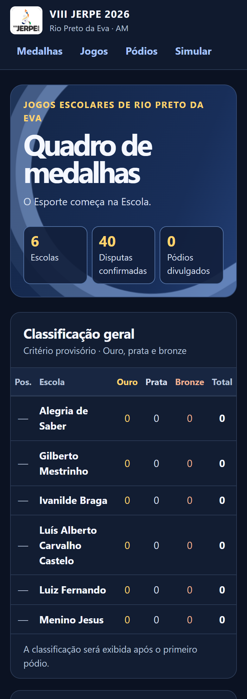

# VIII JERPE 2026

Painel independente para acompanhar os Jogos Escolares de Rio Preto da Eva, no Amazonas. Reúne pódios, quadro de medalhas e jogos em destaque. O responsável pode preparar atualizações no navegador, pelo computador ou celular.

## Demonstração

- [Painel público do JERPE](https://joenosilva-ux.github.io/jerpe-2026/)
- [Editor do campeonato](https://joenosilva-ux.github.io/jerpe-2026/editor/)



## O que o projeto entrega

- **Painel público.** Quadro de medalhas calculado a partir dos pódios, filtros por modalidade e escola e jogos em destaque.
- **Editor no navegador.** Carregamento da base publicada, cadastro e correção de resultados, importação, validação e exportação da base completa.
- **Corrida pelo título.** O editor mostra quantos ouros ainda estão disponíveis e quantos cada escola precisa para ultrapassar ou garantir a liderança em ouros.

## Arquitetura e tecnologias

O projeto usa HTML, CSS e módulos JavaScript nativos. O GitHub Pages serve `docs/` na branch `main`. O painel e o editor leem o mesmo `docs/dados/campeonato.json` e compartilham estilos, validação e regras do campeonato. O editor pode ser aberto por qualquer pessoa com o endereço e prepara alterações no navegador. A atualização pública requer a substituição do JSON no repositório por alguém com permissão no GitHub.

- `docs/` contém o painel, os recursos compartilhados e a base de dados.
- `docs/editor/` contém a interface de edição e a Corrida pelo título.
- `testes/` contém os cenários automatizados do campeonato.
- `documentacao/` contém o guia de operação e as decisões de engenharia.

## Executar e testar

Na raiz do projeto, com Python disponível:

```powershell
python -m http.server 8080 --bind 127.0.0.1 --directory docs
```

Abra o [painel](http://127.0.0.1:8080/) ou o [editor](http://127.0.0.1:8080/editor/). Com Node.js disponível, use `node --test` para executar os testes.

## Limitações

O painel registra pódios e confrontos selecionados. A classificação por ouro, prata e bronze ainda é provisória. A Corrida pelo título presume que cada escola pode disputar todos os ouros em aberto. A próxima revisão depende da confirmação do regulamento geral e das disputas pendentes pela organização.

## Documentação

- [Guia de operação e publicação](documentacao/operacao.md)
- [ADR 001 — Um JSON como fonte única](documentacao/adr/001-fonte-unica-de-dados.md)
- [ADR 003 — Editor estático no GitHub Pages](documentacao/adr/003-editor-no-github-pages.md)
